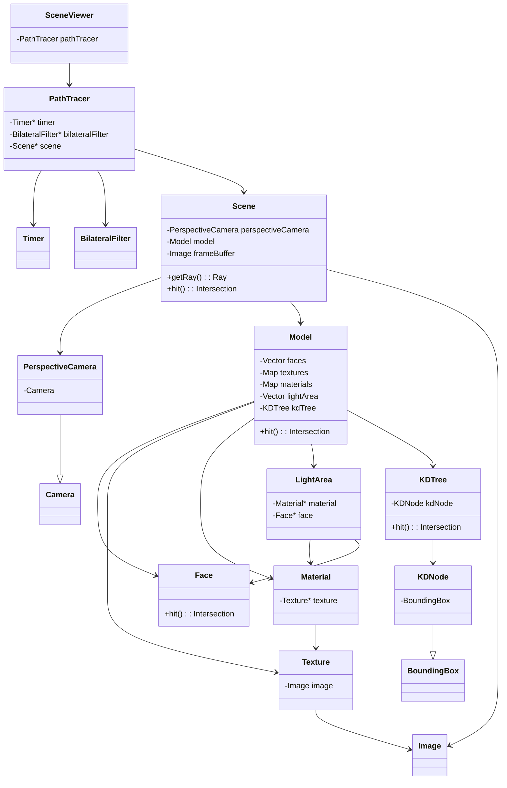

<div align="center">
<font size = 6 color = "black" face = "KaiTi"><b>贺俊哲</b></font><br>
<font size = 4 color = "black" face = "KaiTi">学号: 22421256</font><br>
<font size = 4 color = "black" face = "KaiTi">邮箱: hejunzhe@zju.edu.cn</font><br>
</div>


[TOC]

# 简介
本项目实现了简易的 [Monte Carlo 光线追踪](https://en.wikipedia.org/wiki/Path_tracing)。具体包括

+ 利用 `tinyobjloader` 和 `tinyxml2` 库实现了对模型 3D 文件 `.obj`、模型纹理`.mtl` 和配置文件 `.xml` 的加载。
+ 使用 [KD-Tree](https://en.wikipedia.org/wiki/K-d_tree) 数据结构加速模型与光线的求交计算。
+ 使用迭代的方法进行 Monte Carlo 光线追踪, 在每一轮迭代中并行地对每个像素进行追踪, 最终像素值取各轮像素的均值。
+ 使用 [GLFW](https://github.com/glfw/glfw) 创建了显示窗口, 可以显示当前渲染结果。
+ 可以选择对渲染结果进行[双边滤波](https://en.wikipedia.org/wiki/Bilateral_filter); 或者将渲染结果保存为图片。在 `.xml` 配置文件进行设置。

具体见后文中 “说明” 一节。


# 开发环境
我的环境
<table align="center" border="l">
		<tr>
			<td style="font-weight: bold;" >系统</td>
			<td>Windows 11 专业版 24H1</td>
        </tr>
        <tr>
            <td style="font-weight: bold;" rowspan="2"> 编译器 </td>
            <td>GCC 13.2.0</td>
        </tr>
        <tr>
            <td>MSVC 19.39.33519.0</td>
        </tr>
        <tr>
            <td style="font-weight: bold;" rowspan="4"> 编译配置工具</td>
            <td>cmake 3.30.3</td>
        </tr>
        <tr>
            <td>GNU make 3.80</td>
        <tr>
        <tr>
            <td>MSBuild 17.9.5 for .NET Framework</td>
        </tr>
        <tr>
            <td style="font-weight: bold;" rowspan="4"> 并行化库 </td>
            <td>OpenMP 4.5</td>
        </tr>
</table>

使用到的第三方库:
+ [GLM 0.9.9.8](https://github.com/g-truc/glm/releases/tag/0.9.9.8) , GLAD, [GLFW](https://github.com/glfw/glfw);
+ [stb](https://github.com/nothings/stb);
+ [tinyobjloader](https://github.com/tinyobjloader/tinyobjloader);
+ [tinyxml2](https://github.com/leethomason/tinyxml2)。

# 项目构建
在 Windows 系统中, 可以直接运行 `build.ps1`  即可完成 git clone 第三方库、编译等操作。手动构建项目的方法如下。

## 配置第三方库

 git clone 所需的第三方库到 `.\third_party`:
```shell
git clone https://github.com/g-truc/glm.git ./third_party/glm
git clone  https://github.com/glfw/glfw.git ./third_party/glfw
git clone https://github.com/nothings/stb.git ./third_party/stb
git clone https://github.com/tinyobjloader/tinyobjloader.git ./third_party/tinyobjloader
git clone https://github.com/leethomason/tinyxml2.git ./third_party/tinyxml2
```
## Windows 平台构建
本项目可在 Windows 平台上使用两种方法构建：
+  GNU GCC + GNU make 构建项目
```shell
mkdir build
cmake -G "Unix Makefiles" -Bbuild .
cmake --build build --parallel 16
```
+ 使用 MSVC 构建项目
```shell
mkdir build
cmake -G "Visual Studio 17 2022" -A x64 -Bbuild .
cmake --build build --config Release --parallel 16
```
在构建完成后运行 `project.exe` 即可 （路径一般为 `.\build\Release\project.exe` 或者 `.\build\project.exe`）。

`project.exe` 的运行参数如下：
```
$ .\project.exe --help

Usage: main [options]
Options:
    --objFilePath, -obj <path>        Path to the .obj file.
    --configFilePath, -config <path>  Path to the config (.xml) file.
    --mtlFilePath, -mtl <path>        Path to the .mtl file.
    --sceneName, -n <name>            Name of the scene.
    --help, -h                        Print this help message.
```
示例使用：
```shell
.\project.exe -obj .\example-scenes-cg24\bathroom2\bathroom2.obj -config .\example-scenes-cg24\bathroom2\bathroom2.xml -mtl .\example-scenes-cg24\bathroom2\bathroom2.mtl -n bathroom2
```

## Linux 平台构建

经测试, 本程序可在 Ubuntu 22.04.5 LTS (WSL2) 下成功编译。
安装相关库
```bash
# GLFW 依赖
sudo apt-get install -y libx11-dev
sudo apt-get install -y libxrandr-dev
sudo apt-get install -y libxinerama-dev
sudo apt-get install -y libxcursor-dev
sudo apt-get install -y libxi-dev
```
其余步骤与 Windows 平台使用 GCC 和 GNU Make 构建的方法基本相同。
```bash
cmake -G "Unix Makefiles" -Bbuild . -DCMAKE_BUILD_TYPE=RELEASE
cmake --build build --parallel 16
```
运行 `./build/project` 的方式如前述。

## 其它

+ `lightsamples` 和 `maxdepth` 会对程序运行效率产生较大影响, 不宜设为过大的值。
+ 若 Powershell 终端非 Powershell 7.x (如 PC 自带的 Windows Powershell 5.1)，且运行 `build.ps1` 出现报错和中文乱码，请将  `build.ps1`  中的编码保存为 `UTF-8 with BOM`。否则，请保持 `build.ps1` 为 `UTF-8 ` 编码。*c.f.* [about_Character_Encoding - PowerShell | Microsoft Learn](https://learn.microsoft.com/en-us/powershell/module/microsoft.powershell.core/about/about_character_encoding?view=powershell-7.5#the-byte-order-mark)。
+ 程序目录中请勿使用非 ASCII 字符。

# 说明

## 配置参数
一个示例配置文件如下：
```xml
<?xml version="1.0" encoding="utf-8"?>
<camera type="perspective" fovy="20.1143">
	<eye x="27" y="5.2" z="0.0"/>
	<lookat x="200" y="4" z="2.0"/>
	<up x="0.0" y="1.0" z="0.0"/> 
</camera>

<scene width="1280" height="720" ambient="0.2, 0.2, 0.2"/>

<light mtlname="light1" radiance="300,300,300"/>
<light mtlname="light2" radiance="50,50,50"/>
<light mtlname="light3" radiance="20,20,20"/>
<light mtlname="light4" radiance="10,10,10"/>

<pathtrace lightsamples="3" maxdepth="3" filterfrequence="0" saveimgfrequence="100" saveimgpath="./result/veach-mis"/>
```
其中参数包括:
+ `camera` 相机
    - 相机采用右手坐标系;
    - `type`:   相机类型 (目前仅支持 `persepctive`, 即标准针孔透视相机);
    - `fovy`:   相机垂直视场角, 单位为度 (degrees);
    - `eye`:    相机在世界坐标系下的位置;
    - `lookat`: 相机世界坐标系下指向的目标方向;
    - `up`:     相机在世界空间中的上轴。
+ `scene` 场景
    - `width`、`height`: 窗口的宽和高;
    - `ambient`:    场景的环境光。
+ `light` 光照
    - `mtlname` :   材质名称, 必需在材质文件 `.mtl` 中出现过;
    - `radiance`:   光源辐射亮度, 包含 rgb 值的字符串, 使用逗号隔开;
    - 场景中光照可以有多个。
+ `pathtrace`   光线追踪相关参数
    - `lightsamples`:   在光线追踪过程中, 对每个像素进行直接光照采样的次数。该参数会对程序运行效率产生较大影响;
    - `maxdepth`:   对单个像素进行光线追踪的最大递归层数;
    - `filterfrequence`:    每多少轮迭代进行一次双边滤波, 0 表示不进行滤波。双边滤波可能会损失一些高频信息。
    - `saveimgfrequence`:   每多少轮迭代保存一次渲染结果。同时保存过程中对像素进行了 gamma 矫正。0 表示不保存。
    + `saveimgpath`:    保存图片的路径。

## 3D 模型
要求使用标准 [.obj](https://en.wikipedia.org/wiki/Wavefront_.obj_file) 文件将场景几何体数据存储在三角形网格中。点的坐标采用右手坐标系。使用标准 [.mtl](https://www.fileformat.info/format/material/) 文件来存储 phong 材料参数; 用 usemtl 在 `.obj` 文件中描述指定材料和几何图形之间的关系。Phong 模型的参数包括但不限于：
- *Kd*：材料的漫反射率, *map_Kd* 是纹理文件路径 (绝对路径或者相对于 `.mtl` 文件的路径)。
- *Ks*：材料的镜面反射率。
- *Ka*: 材料的环境光反射系数。
- *Ke*: 自发光材料的辐射亮度, 对应 `.xml` 文件里光照的 `radiance`。
- *Tr*：材料的透射率。
- *Ns*：光泽度 (shiness), phong lobe 中的指数。
- *Ni*：透明物体（如玻璃和水）的折射率 (IOR)。

## 数据结构
如下是 `./src` 下的项目文件描述, 以及其中包含的类。
+ `Camera.h`:
    - `PerspectiveCamera`: 标准针孔透视相机。
+ `Ray.h`:
    - `Ray`: 用于描述场景中的射线, 用于射线于模型求交计算, 或者计算光线的折射和反射。
+ `Geometry.h`、`Geometry.cpp`:
    - `BoundingBox`: AABB 包围盒。
    - `Face`:   用于描述模型中的三角形面片, 包含了面片的顶点位置、法向量、材质信息, 也实现了相关的计算, 如随机采样、计算面积、计算纹理坐标、计算重心坐标、计算射线于面片求交等。
    - `Intersection`:   记录射线与面片相交的信息。
+ `Material.h`、`Material.cpp`:
    - `Material`:   用于保存 `.mtl` 里的材质信息, 包括纹理贴图等。
    - `Image`:  图像类, 用于对图像进行文件读/写; 可对纹理以及帧缓存进行管理。
    - `Texture`:    用于管理纹理贴图。
+ `KDTree.h`、`KDTree.cpp`:
    - `KDNode`: KD-Tree 的结点,结点本身是一个包围盒, 其中记录了包围盒中包含的面片; 左子树和右子树是对该包围盒进行分割得到的更小的包围盒。
    - `KDTree`: 为模型所有面片构建的 KD-Tree, 用于加速模型与射线求交。在构建时每层结点轮换使用不同的轴。
+ `Model.h`、`Model.cpp`:
    - `LightArea`: 用于记录模型中的一整块发光部分, 模型中国你所有属于同一种发光材料的面片都归入同一个 `LightArea` 管理。可用于在路径追踪中进行随机选取。
    - `Model`:  用于管理 3D 模型, 包括管理模型的所有面片、材质、纹理、光源。
+ `Scene.h`、`Scene.cpp`:
    - `Scene`: 管理场景, 除了 3D 模型外, 还记录了相机、窗口、帧缓存等信息。`Scene::getRay` 会在路径追踪中调用, 从窗口的 $(x,y)$ 坐标处选取发射射线。
+ `PathTracer.h`、`Patheracer.cpp`:
    - `PathTracer`: 用于对当前场景进行路径追踪。其中, `PathTracer::renderScene` 相当于进行一轮迭代, 调用 `PathTracer::traceRay` 对窗口中每一个像素进行光线追踪, 并更新场景中的帧缓存, 由于每个像素之间是无关的, 因此使用 OpenMP 并行进行。
+ `SceneViewer.h`、`SceneViewer.cpp`:
    + `SceneViewer`:    在路径追踪的过程中, 将渲染结果显示在窗口上。使用 GLFW 实现窗口页面。

部分关系如下所示：



# 运行结果
## bathroom2
<div align="center">

</div>
路径追踪过程可视化:
<div align="center">

</div>


## cornell-box

<div align="center">

</div>
路径追踪过程可视化:
<div align="center">

</div>

## veach-mis
<div align="center">

</div>
路径追踪过程可视化:
<div align="center">

</div>