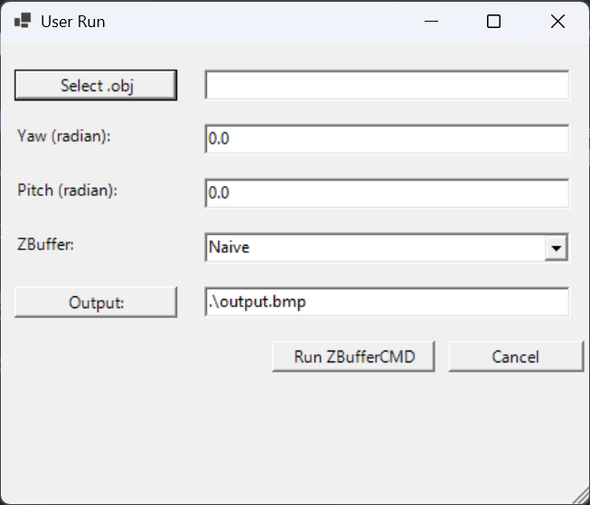
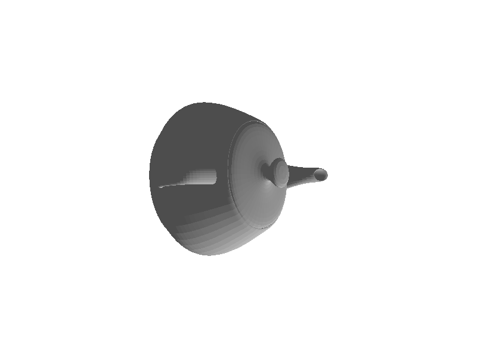
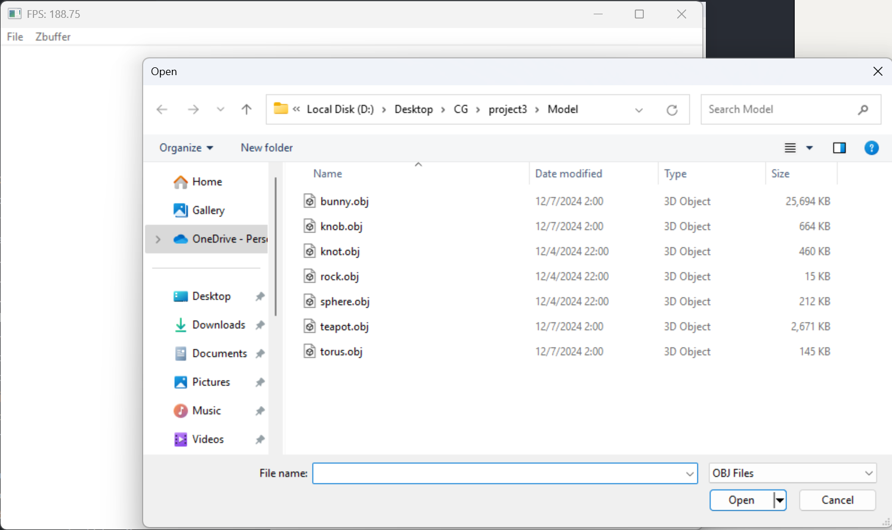
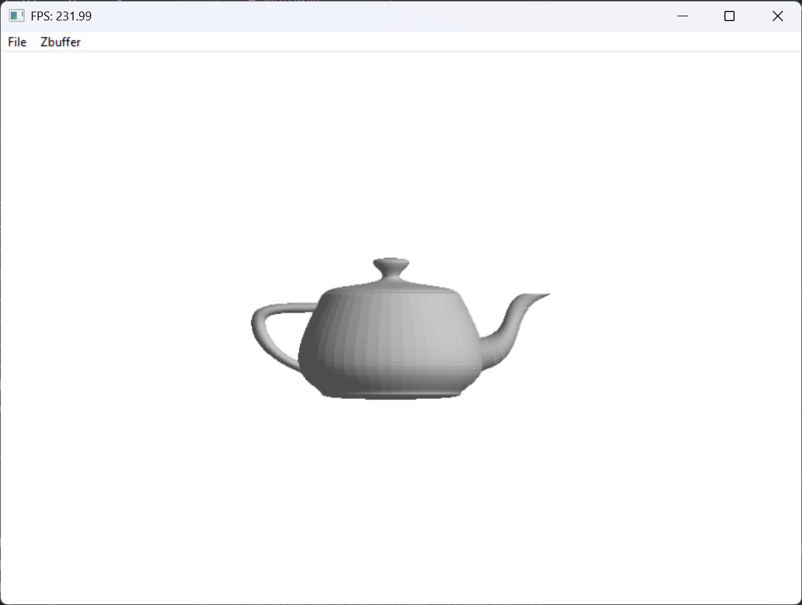
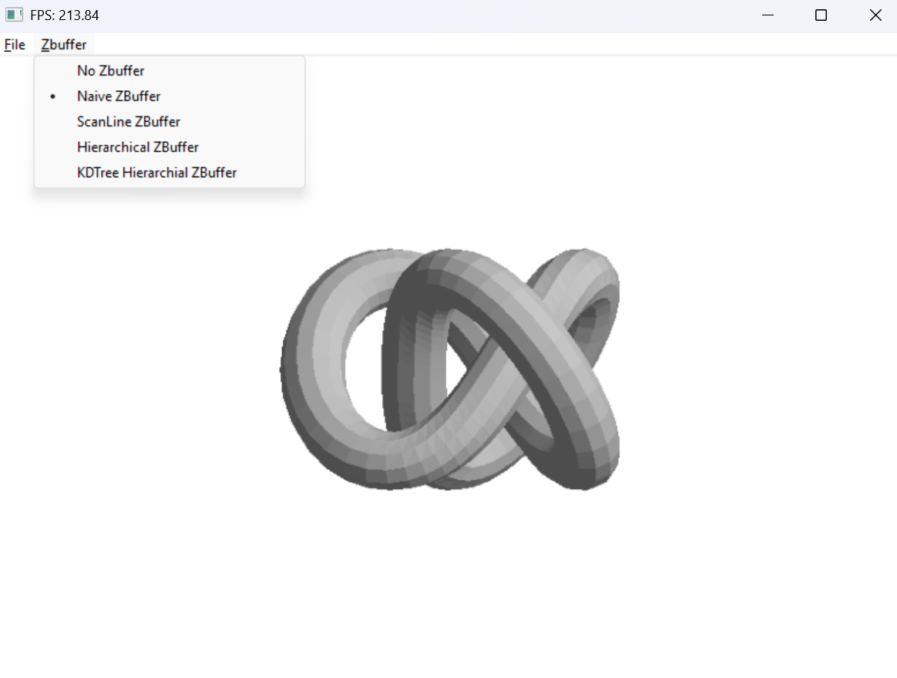
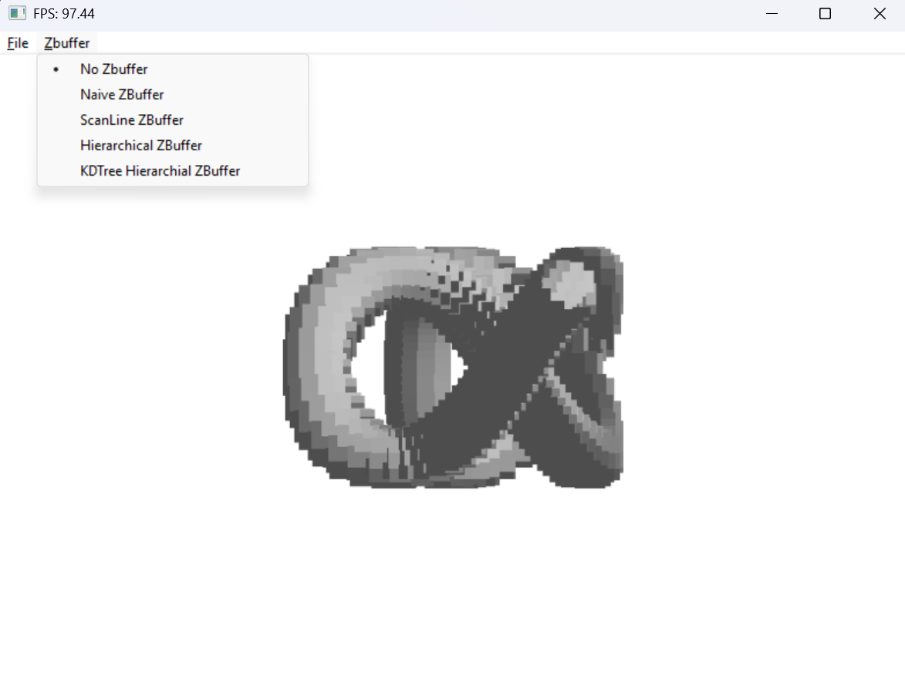
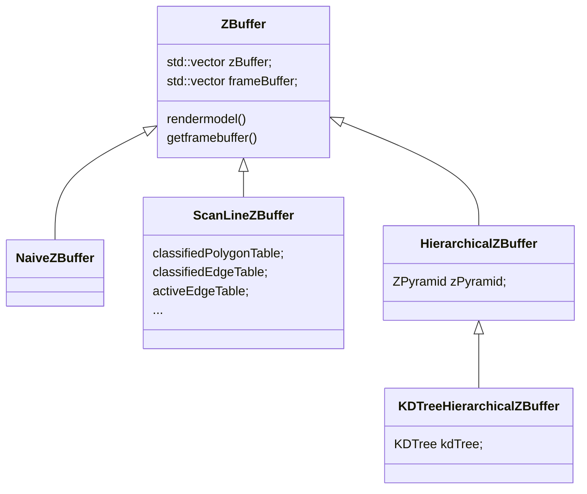
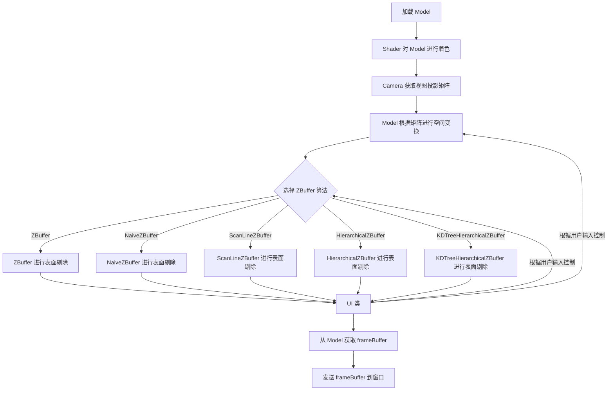
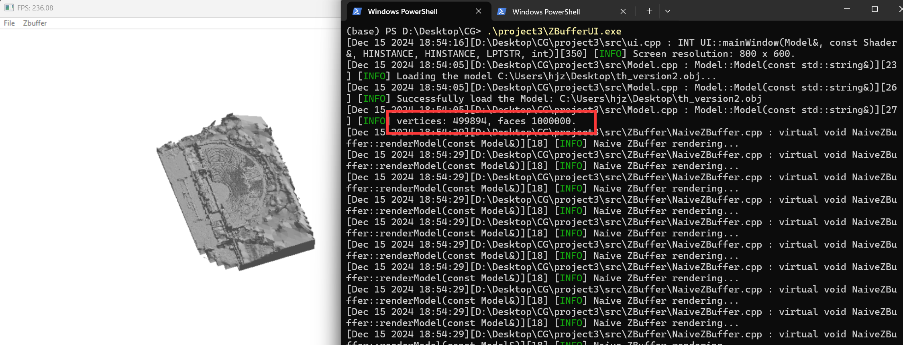

# 简介
本项目实现了 .obj 三维模型的渲染并应用不同的表面剔除算法, 包括
+ 无 ZBuffer
+ 普通 Z-Buffer
+ 扫描线 Z-Buffer
+ 层次 Z-Buffer
+ 使用 KD-Tree 的层次 Z-Buffer

# 开发环境
我的环境:

<table align="center">
		<tr>
			<td style="font-weight: bold;">系统</td>
			<td>Windows 11 专业版 24H1</td>
        </tr>
        <tr>
			<td style="font-weight: bold;">GCC</td>
			<td>13.2.0<br> Target: x86_64-w64-mingw32</td>
        </tr>
        <tr>
            <td style="font-weight: bold;">GNU Make</td>
			<td>3.80</td>
        </tr>
        <tr>
            <td style="font-weight: bold;">Powershell</td>
			<td>7.4.6</td>
        </tr>
        <tr>
            <td style="font-weight: bold;">DirectX</td>
			<td>DirectX9<br> SDK version: 32</td>
        </tr>
</table>


# 文件说明

```PlainText
.
│  make.bat                 # 运行 make.bat 进行编译, 功能等同于 Makefile
│  make.ps1                 # 运行 make.ps1 进行编译, 功能等同于 Makefile
│  Makefile                 # 使用 make 指令编译项目
│  ReadMe.md
│  testElapsedTime.ps1      # 指定 .obj 文件, 调用 ZBufferCMD.exe 计算四种算法的渲染时间
│  userRun.ps1              # 一个运行 ZBufferCMD.exe 的 GUI 页面, 可以设置参数
│  ZBufferCMD.exe           # 命令行模式运行的主程序, 可以指定剔除算法, 输出渲染图片
|                           # 使用 .\ZBufferCMD.exe --help 查看参数
│  ZBufferUI.exe            # 增加 GUI 页面的主程序, 可以实时渲染模型, 支持视角旋转
│      
├─Model                     # 放置 .obj 三维模型的目录
│      objInfo.ps1          # 运行 ./objInfo.ps1 查看该目录下 .obj 模型的信息
│      torus.obj
│       ...
│
├─src
│  │  defs.h                # 各种宏定义
│  │  mainCMD.cpp           # ZBufferCMD.exe 主程序
│  │  mainUI.cpp            # ZBufferUI.exe 主程序
│  │  Model.cpp             # 实现了 Model 类, 用于加载模型、进行空间变换、计算深度等 
│  │  Model.h
│  │  Shader.cpp            # 实现了光源, 用于渲染 Model
│  │  Shader.h
│  │  ui.cpp                # 实现了相机和 UI 类
│  │  ui.h
│  │  utils.cpp             # 一些杂的会用到的函数
│  │  utils.h
│  │
│  └─ZBuffer                                # 各种 Z-Buffer 算法实现
│          ZBuffer.cpp                      # ZBuffer 基类, 定义了接口
|                                           # 直接使用基类代表“不使用 Z-Buffer 直接渲染”
|                                           # 下面的各种 Z-Buffer 都继承该基类
│          ZBuffer.h
│          NaiveZBuffer.cpp                 # 普通的 Z-Buffer
│          NaiveZBuffer.h
│          ScanLineZBuffer.cpp              # 扫描线 Z-Buffer
│          ScanLineZBuffer.h
│          HierarchicalZBuffer.cpp          # 层次 Z-Buffer
│          HierarchicalZBuffer.h
│          KDTreeHierarchialZBuffer.cpp     # 使用 KD-Tree 的层次 Z-Buffer 
|                                           # 继承 HierarchicalZBuffer
│          KDTreeHierarchialZBuffer.h
```

# 使用说明
+ 本项目使用的 DirectX9 和 MFC 都来自 Windows API, 无需配置环境。
+ 直接运行 make 进行编译, 会在目录下生成两个可执行文件 `ZBufferCMD.exe` 和 `ZBufferUI.exe`。

### ZBufferCMD.exe
`ZBufferCMD.exe` 是一个从命令行运行的程序, 可以指定 .obj 文件和视角, 以及指定 Z-Buffer 渲染算法, 生成一张 .bmp 图像, 参数如下
```PlainText
.\ZBufferCMD.exe --help

Usage: program [OPTIONS]
Options:
  --file -F          .obj file path
  --yaw -Y           angle of yaw in radians (float)
  --pitch -P         angle of pitch in radians (float)
  --output -O        output image path, with .bmp as suffix, default is ./output.bmp
  --zbuffer -Z       Z-buffer choice (no, naive, scanline, hierarchical, kdtree)
  --all              run all Z-buffer choices, and ignore the --zbuffer argument.
  --help -H          show this help information
```
亦可使用目录下的 `userRun.ps1` , 以 GUI 模式设置 `ZBufferCMD.exe` 的参数并运行。如下

<div align = "center">

</div>

运行 ZBufferCMD.exe 的范例:
```PlainText
.\ZBufferCMD.exe --file .\Model\teapot.obj --yaw 1.0 --pitch 1.5 --output .\output\teaport.bmp --zbuffer naive 
```
输出 `output\teaport.bmp`:
<div align = "center">

</div>

运行 `ZBufferCMD.exe` 再给出渲染图片的同时会在输出 log 中给出所选 Z-Buffer 算法对模型进行表面剔除的运行时间。

若要比四种算法的运行时间, 请运行 `testElapsedTime.ps1`, 其会调用 `ZBufferCMD.exe` 并比较无 Z-Buffer 以及四种 Z-Buffer 算法的耗时。范例如下
```PlainText
.\testElapsedTime.ps1 .\Model\teapot.obj | Format-Table -Property  Algorithm, @{Name="Time";Expression={"$($_.Time) seconds"}} -AutoSize
```
运行结果
```PlainText
For file .\Model\teapot.obj :

Algorithm               Time
---------               ----
NoZBuffer               0.003 seconds
NaiveZBuffer            0.012 seconds
ScanlineZBuffer         0.015 seconds
HierarchialZBuffer      0.039 seconds
KDTreeHierchialZBuffer  0.061 seconds
```

### ZBufferUI.exe
`ZBufferCMD.exe` 是一个 GUI 程序, 运行页面如下:
<div align = "center">

</div>


File 菜单可以呼出文件窗口管理器, 选择 obj 文件。
<div align = "center">
<table align="center">
<tr>
<td>

</td>
<td>

</td>
</tr>
<tr>
<td colspan="2" align = "center">

</tr>
<td>
</table>
</div>

键盘的上下左右按键可以旋转物体。
<div align = "center">

</div>

ZBuffer 菜单可以选择不同的 Z-Buffer 表面剔除算法。

<div align = "center">
<table align="center">
<tr>
<td colspan="2" align = "center">

</td>
<td>

</td>
</tr>
</table>
</div>

### 其它说明

+ .obj 模型仅允许三角形或四边形面片, 否则会读取失败。
+ 对于较大的 .obj 文件 (例如 `Model\bunny.obj`, 共 72027 个顶点、144046 个面), 模型读取的时间可能较长 (本机测试加载 `Model\bunny.obj` 需要 50 秒), 请耐心等待。
+ 扫描线 Z-Buffer 实现有瑕疵, 某些模型的细节处可能渲染失败, 推测是浮点误差导致。 
+ **DirectX9 仅用于将 ZBuffer 类中的数据发送到窗口, 没有调用涉及 Z-Buffer 的API。**

# 数据结构
+ `Vec3f`、`Point3f`、`Vec2f`、`Color`、`Light`、`Matrix4x4f`、`Plane` (defs.h): 直接作为 DirectX9 中类的别名:
    - 三维点 `Vec3f`、`Point3f` 是 `D3DXVECTOR3` 的别名;
    - 二维点 `Vec2f` 是 `D3DXVECTOR2` 的别名;
    - 颜色 `Color` 是 `D3DXCOLOR` 的别名, 包含 ARGB 四个通道;
    - 光线类 `Light` 是 `D3DLIGHT9` 的别名;
    - $ 4\times 4$ 矩阵 `Matrix4x4f` 是 `D3DXMATRIX` 的别名;
    - 平面 `Plane` 是 `D3DXPLANE` 的别名, 包含 a、b、c、d 四个参数。
    - DirectX9 中定义的这些类可以方便地进行一些计算, 如向量和矩阵的运算等。其定义见头文件 `d3dx9math.h`。
+ `Vectex`、`Face`、`BoundingBox` 类  (Model.h): 分别代表顶点、面和包围盒, 用于存储模型数据。`Vectex` 中包含点的空间坐标和该点处的法线, `Face` 包含顶点索引 (而非具体顶点位置) 、法线和颜色等。在加载模型过程中, 程序会为每个面以及整个模型计算包围盒。
+ `Model` 类 (Model.h): 用于加载 .obj 模型, 保存模型的顶点、面的数据, 同时可以对模型进行空间变换, 以及计算深度。
+ `Shader` 类 (Shader.h): 实现了一个点光源, 使用 Lambert 光照模型对物体表面进行着色。
+ `Camera` 类 (ui.h): 实现了一个简单的相机模型, 可以设置偏航角和俯仰角, 得到视图投影 (旋转) 矩阵; 对物体进行相应的旋转变换即可得到相机视角下的图像。
+ `UI` 类 (ui.h) 使用 DirectX9 和 MFC 实现一个了 GUI 页面。主窗口循环中将 `frameBuffer` 中的颜色数据发送到窗口中进行显示 (见 `UI::render_frame()` 函数)。对模型的渲染采用懒惰的模式: 只有遇到模型空间变换、加载新模型或者更改 Z-Buffer 算法时才会重新计算  `frameBuffer`, 这些信息通过全局变量在窗口回调函数和 `UI` 类之间传递。 
+ `ZBuffer` 类 (ZBuffer.h): 所有 ZBuffer 算法的基类, 包含两个成员变量: `zBuffer` 代表深度缓冲区、`frameBuffer` 代表帧缓冲区; 以及两个接口: `renderModel`: 根据 `Model` 输入, 按照相应的表面剔除算法填充 `zBuffer` 与 `frameBuffer` 的值, `getFrameBuffer`: 用户获取 `frameBuffer` 的数据指针。 `renderModel` 实现为虚函数, 后续的所有算法都需要覆盖实现。若直接调用基类的 `renderModel` 函数, 则代表“不使用 Z-Buffer 直接渲染”。
+ `NaiveZBuffer` 类 (NaiveZBuffer.h): 普通的 Z-Buffer, 继承自 `ZBuffer` 类, 依次渲染每个面片并检查深度。
+ `ScanLineZBuffer` 类 (ScanLineZBuffer.h): 扫描线 Z-Buffer, 继承自 `ZBuffer` 类, 每次渲染时, 会会首先根据边和三角形面片的最大 y 值来建立分类边表、三角形表和活化边表; 随后开始逐行向下扫描, 不断更新三个表的内容, 同时利用面片的连续性, 增量式地计算面片深度，并依次更新深度缓冲实现消隐。由于每次只会进行一行扫描线的渲染, 因此其深度缓冲区大小仅等于窗口宽度, 从而节省了空间开销。
+ `QuadNode` 和 `Zpyramid` (HierarchialZBuffer.h): 四叉树结点和四叉树实现。通过层次化的方式将整个屏幕区域划分为更小的矩形区域, 大矩形作为其包含的小矩形的父结点, 可以递归地为整个像素空间建立为一个树状结构, 即四叉树。四叉树的某个结点可以对其子树进行深度值的管理, 从而实现速度优化。
+ `HierarchialZBuffer` 类 (HierarchialZBuffer.h): 层次 Z-Buffer, 继承自 `ZBuffer` 类, 利用分层的 Z-Buffer（即四叉树结构的 Z-Pyramid）来优化 3D 模型的渲染过程。具体而言, 遍历模型中的每个面, 并递归寻找包含该面的四叉树结点, 若面所在的包围盒深度低于当前结点的深度值，则不进行渲染; 否则递归寻找子结点, 直至找到最小的包含给顶面之包围盒的四叉树结点, 更新当前结点及其子结点的深度值, 并更新帧缓冲区。
+ `KDNode` 和 `KDTree`  (KDTreeHierarchialZBuffer.h): KD-Tree 结点与 KD-Tree, 实现对场景的管理。具体而言, KD-Tree 依次选择不同的坐标轴对空间进行切割, 并递归地构建左右子节点, 直至所在空间仅包含一个面片, 则让这部分空间作为叶子节点。
+ `KDTreeHierarchicalZBuffer ` 类 (KDTreeHierarchialZBuffer.h): 实现了带 KD-Tree 的层次 Z-Buffer, 继承自 `HierarchialZBuffer` 类。该方法通过使用 KD-Tree 来管理场景中的面片, 并通过层次化的 Z-Buffer 实现高效的 Z-Buffer 管理。递归渲染 KD-Tree 的方法如下:
    - 若 KD-Tree 结点的最大深度值小于当前四叉树结点的深度值，则不进行渲染。
    - 若 KD-Tree 结点为叶子结点，直接渲染该结点对应的面片。
    - 若四叉树结点包含 KD-Tree 结点的包围盒投影，则递归渲染四叉树的子结点。
    - 若四叉树子结点不包含 KD-Tree 结点的包围盒投影，则递归渲染 KD-Tree 的左右子结点。

如下是各 Z-Buffer 算法的继承关系图


程序流程如下




# 运行结果
.obj 数据如下:
```PlainText
.\Model\objInfo.ps1 | Sort-Object -Property Vertices

Name       Size (KB) Vertices  Faces
----       --------- --------  -----
rock.obj       14.90       98    192
torus.obj     144.63      625    625
knot.obj      459.86     1440   2880
sphere.obj    211.94     1562   1600
knob.obj      663.50     1996   3984
teapot.obj   2670.66     7850  15704
bunny.obj   25693.78    72027 144046
```
对各个 obj 数据计算不同 Z-Buffer 算法的时间。Powershell 指令:
```PlainText
Get-ChildItem -Path './Model' -Filter '*.obj' | ForEach-Object {
    $r = [ordered]@{Name = $_.Name}
    & ./testElapsedTime.ps1 $_ "./output/$($_.BaseName).bmp" -echo $false | `
        ForEach-Object { $r[$_.Algorithm] = $_.Time }
     New-Object PSObject -Property $r
}  | Format-Table -AutoSize
```
输出结果 (单位: 秒):
```PlainText
Name       NoZBuffer NaiveZBuffer ScanlineZBuffer HierarchialZBuffer KDTreeHierchialZBuffer
----       --------- ------------ --------------- ------------------ ----------------------
bunny.obj  0.008     0.036        0.241           0.143              0.264
knob.obj   0.004     0.020        0.008           0.059              0.058
knot.obj   0.003     0.015        0.007           0.043              0.048
rock.obj   0.003     0.007        0.003           0.023              0.024
sphere.obj 0.003     0.011        0.004           0.031              0.032
teapot.obj 0.003     0.013        0.015           0.040              0.059
torus.obj  0.003     0.012        0.004           0.032              0.036
```


可以看到, 除了无 Z-Buffer 和普通 Z-Buffer 的情况最快外, 扫描线 Z-Buffer 也有着较快的速度; 而层次 Z-Buffer 和 KD-Tree Z-Buffer 速度较慢, 分析原因在于四叉树与 KD-树的递归过程复杂, 并且程序实际上是在用 CPU 模拟 GPU 计算, 无法利用硬件的分布式加速。同时, 部分物体模型普遍面片较小, 并不会遮挡到太多的其它面片, 在使用四叉树 (以及 KD-树) 时根据深度进行剪枝的情况并不多, 因而加速不明显。

但另一方面, 根据 `bunny.obj` 行可以看出, 在物体规模增大时, 扫描线 Z-Buffer 算法的耗时增长幅度较大, 而两个层次 Z-Buffer 则不然。为了验证这种现象, 尝试使用一个 499894 个顶点、1000000 个面的大型 .obj 模型 ([链接](https://sketchfab.com/3d-models/ancient-greek-theater-acropolis-50531350a6b84337b95c7c29952308e5)), 各算法的耗时开销如下:
```PlainText
Algorithm              Time
---------              ----
NoZBuffer              0.054
NaiveZBuffer           0.266
ScanlineZBuffer        6.001
HierarchialZBuffer     0.898
KDTreeHierchialZBuffer 2.942
```

说明相比于扫描线 Z-Buffer, 层次 Z-Buffer 在对大规模场景进行剔除中更有效果。
<div align = "center">

</div>
