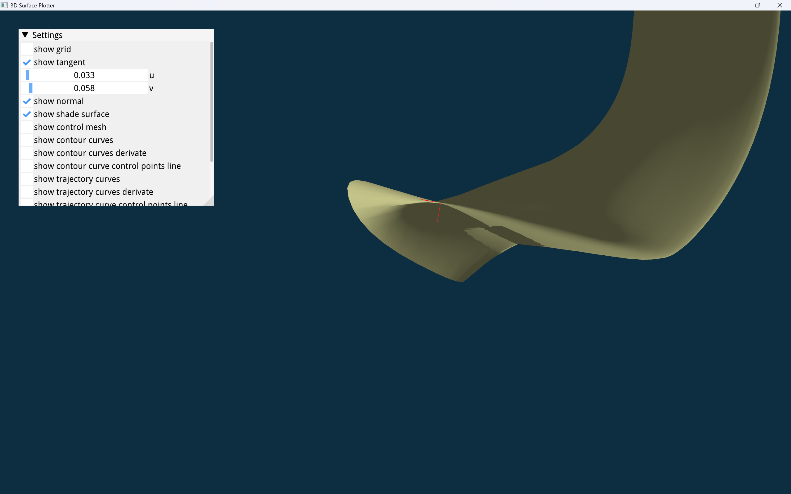
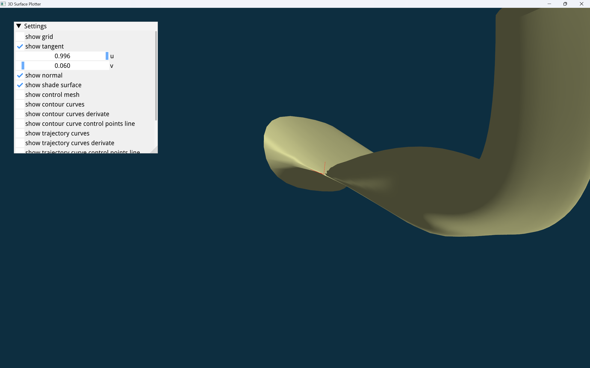
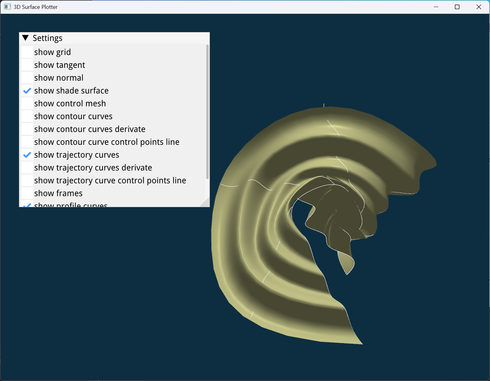
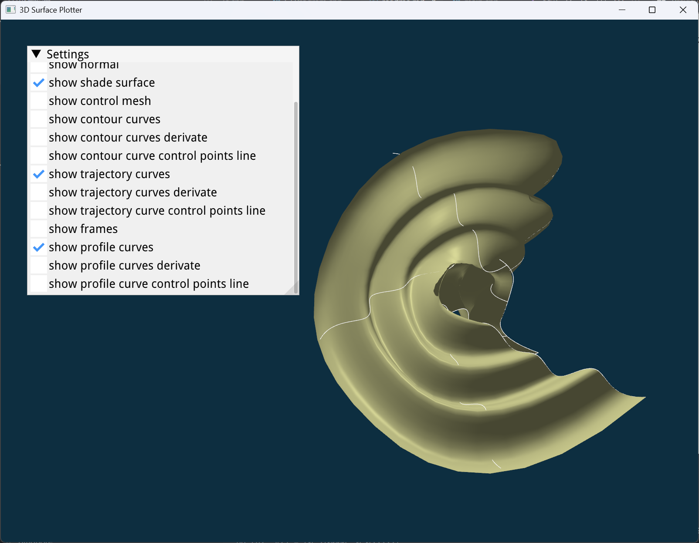

<div align="center">
<font size = 6 color = "black" face = "KaiTi"><b>贺俊哲</b></font><br>
<font size = 4 color = "black" face = "KaiTi">学号: 22421256</font><br>
<font size = 4 color = "black" face = "KaiTi">浙江大学计算机科学与技术学院 硕士一年级</font><br>
<font size = 4 color = "black" face = "KaiTi">邮箱: hejunzhe@zju.edu.cn</font><br>
</div>


# 简介
本项目在给定框架的基础上实现了

+ 实现了 NURBS 曲线和曲面类 `RationalCurve3f` 与 `RationalSurface3f`, 并完成了 NURBS 曲线曲面计算的基本功能, 包括曲线曲面求值、求导数、求法向量 (见 `MyTinyNURBS.h/.cpp`);
+ 实现了用于计算曲线上移动标架的 `MovingFrame` 类, 并实现了三种用于扫掠曲面计算的标架 (见 `Frames.h/.cpp`):
    - Frenet-Serret 标架
    - 法线投影 (Projection Normal) 标架
    - 旋转最小化 (Rotation minimization) 标架
+ 实现了扫掠曲面类 `SweptSurface`, 并实现了三种用于计算扫掠曲面的算法 (见 `SweptSurface.h/.cpp`), 来自 *The NURBS Book* 第 10.4 节:
    - 近似方法;
    - 偏移 (Offset) 方法;
    - 蒙面 (Skining) 方法。
+ 最后, 根据给出的轮廓曲线、轨迹曲线生成扫掠曲面, **可以通过形状控制矩阵来控制扫掠曲面的形状**, 并实现了简单的**自相交检测**。

# 开发环境
我的环境
<table align="center" border="l">
		<tr>
			<td style="font-weight: bold;" >系统</td>
			<td>Windows 11 专业版 24H1</td>
        </tr>
        <tr>
            <td style="font-weight: bold;" rowspan="2"> 编译器 </td>
            <td>GCC 13.2.0</td>
        </tr>
        <tr>
            <td>MSVC 19.39.33519.0</td>
        </tr>
        <tr>
            <td style="font-weight: bold;" rowspan="4"> 编译配置工具</td>
            <td>cmake 3.30.3</td>
        </tr>
        <tr>
            <td>GNU make 3.80</td>
        <tr>
        <tr>
            <td>MSBuild 17.9.5 for .NET Framework</td>
        </tr>
</table>

使用到的第三方库或代码:
+ 本项目原始框架: <https://github.com/cindyli-13/3D-Surface-Plotter>;
+ [dear imgui](https://github.com/ocornut/imgui), v1.90;
+ Eigen 3.3.8: <http://eigen.tuxfamily.org/>;
+ GLM 0.9.9.8, GLAD, GLFW 3.3;
+ Nanoflann: <https://github.com/jlblancoc/nanoflann>。

本项目完全**未**用到 [tinynurbs](https://github.com/pradeep-pyro/tinynurbs)。

# 项目构建
git clone 所需的第三方库到 `external`:
```shell
git clone https://github.com/PX4/eigen.git external/eigen
git clone https://github.com/glfw/glfw.git external/glfw
git clone https://github.com/g-truc/glm.git external/glm
git clone https://github.com/jlblancoc/nanoflann.git external/nanoflann
```

示例: 使用 GNU GCC + GNU make 构建项目
```shell 
mkdir build
cmake -G "Unix Makefiles" -Bbuild .
cmake --build build --config Release --parallel 8
```
示例: 使用 MSVC 构建项目
```shell
mkdir build
cmake -G "Visual Studio 17 2022" -A x64 -Bbuild .
cmake --build build --config Release --parallel 8
```
在构建完成后运行 `project.exe` 即可 （路径一般为 `.\build\Release\project.exe` 或者 `.\build\project.exe`）。
运行 `project.exe` 可以增加参数, 从而选择不同的标架算法或者扫掠曲面生成算法, 如下:

```
$ ./project.exe --help
Usage: ./project.exe [options]
Options:
  -s, --surface [0|1|2]  Set Swept Surface Algorithm (0: Approximation, 1: Offset, 2: Skinning), 2 by default.
  -f, --frame [0|1|2]    Set Frame Algorithm (0: FrenetSerret, 1: ProjectionNormal, 2: RotationMinimization), 2 by default.
  -t, --task [1|2]       Select surface to display (between 2 tasks), 1 by default.
  --transfrom            Allowing shape control.
  -h, --help             Show this help message.
```

# 说明
## 对原有框架的修改
进行了比较大的修改, 主要修改有

+ 更改了第三方库的位置, 将 eigen、imgui、glm、glfw 等放在了 `.\external` 目录下。重写编写了 `CmakeLists.txt`。
+ 去掉了 tinynurbs 库, 完全自己实现有理 B 样条曲线和曲面类。
+ 修改了 `GLProgram.cpp` 中部分接口, 并处理了相对路径的问题。
+ 增加了 `MyTinyNurbs.h/.cpp`、`Frame.h/.cpp`、`SweptSurface.h/.cpp` 三个模块 （主要完成了作业要求的部分）。

## 数据结构
+ `MyTinyNurbs.h`:
    + `RationalCurve3f` 类: 有理 B 样条曲线。使用 `Point` 方法可以进行曲线求值、使用 `Derivatives` 方法可以进行曲线求导。
    +  `RationalNormal3f` 类: 有理 B 样条曲线。使用 `Point` 方法可以进行曲面求值、使用 `Derivatives` 方法可以进行曲面求偏导、使用 `Normal` 方法可以进行曲面求法向量。
+ `Frame.h`:
    + `Frame`: 代表曲线上某一点的局部活动标架, 包含 $N$, $B$, $T$ 三个相互垂直的法向量。
    + `MovingFrame` 类: 计算曲线上的一系列局部活动标架, 实现了 Frenet-Serret 标架、法线投影标架以及旋转最小化标架三种计算活动标架的算法。
+ `SweptSurface.h`:
    + `SweptSurface` 类: 根据给定的脊线 (轨迹曲线)、截线 (轮廓曲线) 生成扫掠曲面。实现了近似方法、偏移方法以及蒙面法三种生成扫掠曲面的方法。 

## 自相交检测的实现

见 `Utils.cpp` 中 `Checker::surfaceIsSelfIntersection` 函数实现。

这里用了一个基于采样的方法, 首先根据给定精度在曲面表面生成均匀网格 (相当于将曲面转换成三维网格), 然后再检查是否有两个网格的顶点之间距离低于给定精度值。由于直接两层循环遍历所有采样点的效率太低, 采用 KD-Tree 划分空间、加速搜索。KD-Tree 采用 [nanoflann](https://github.com/jlblancoc/nanoflann.git) 的实现。

例如, 当选择子任务 1 (默认参数) 时, 运行 `project.exe` 会输出一条 log：
```
[WARNING] The surface has self-intersection! The intersection point are (u1, v1) = (0.003333, 0.058333) and (u2, v2) = (0.996667, 0.060000)
```
这说明存在两组参数 $(u_1,v_1)$ 和 $(u_2,v_2)$, $(u_1,v_1)\neq (u_2,n_2)$ 但曲面的值 $S(u_1,v_1)=S(u_2,v_2)$。

<div align="center">
<br>
<font size = 2 color = gray>第一组参数 (0.003333, 0.058333)</font><br>
<br>
<font size = 2 color = gray>第二组参数 (0.996667, 0.060000)</font>
</div>

## 形状控制

形状控制只需在构造 `SweptSurface` 传入一个参数 `shape_controller`, 类型为 `std::function<Mat4f(float)>`。也就是说, `shape_controller` 是一个函数或者可调用对象, 接受一个 `float` 参数 (代表曲线参数)、返回一个 `Mat4` (这是 `glm::mat4` 的别名), 代表变换矩阵。见 `SweptSurface.cpp` 源码。

运行程序时只需增加 `--transfrom` 参数。

例如, 在子任务 2 中设置坐标变换 (除了 `--task 2` 以及 `--transfrom` 外参数默认):

<div align="center">
<br>
<font size = 2 color = gray>无形状控制</font><br>
<br>
<font size = 2 color = gray>由形状控制</font>
</div>

## 其它

+ 剖面曲线 (Profile curves) 的生成采用最简单的对截线 (轮廓曲线) 的控制点进行坐标变换的方法, 在生成扫掠曲线的前两种方法, 即近似方法以及偏移方法里, 可能会出现剖面与曲面有偏差的情况。
+ 曲面自相交检测函数 `Checker::surfaceIsSelfIntersection` 在面对其它情况时可能需要调整参数值, 包括采样密度以及精度阈值。