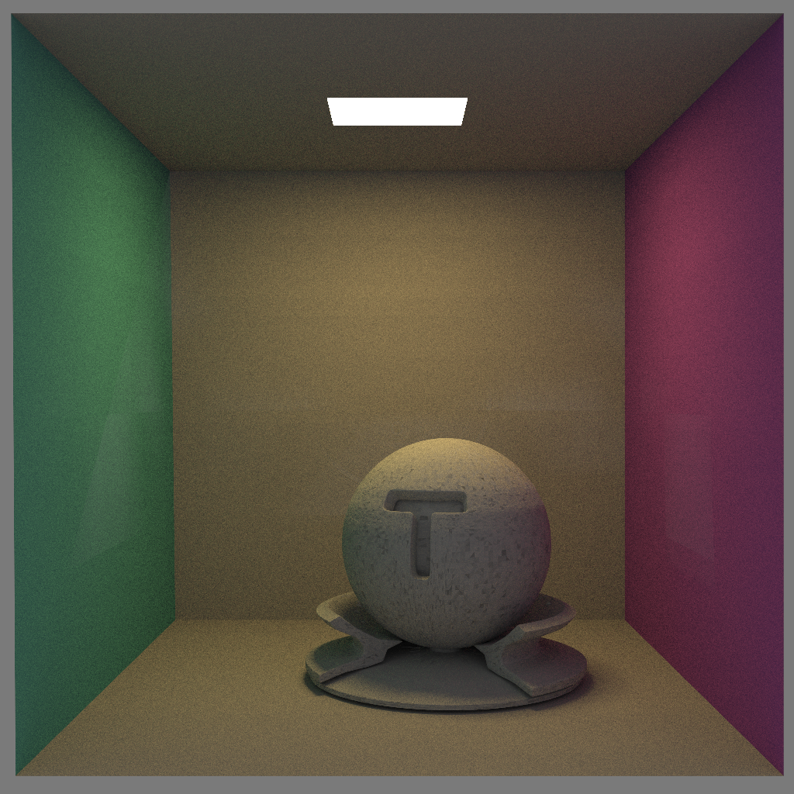
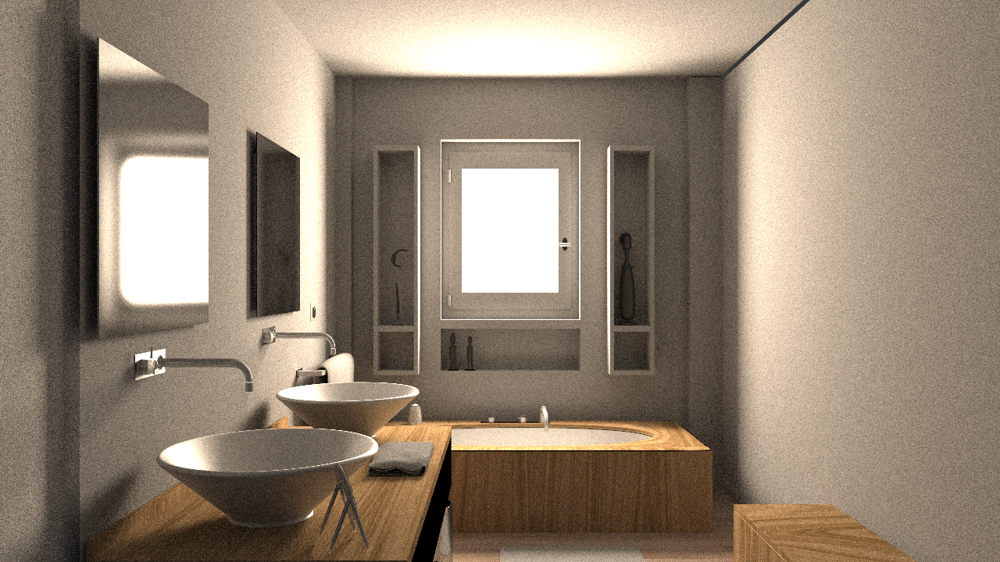
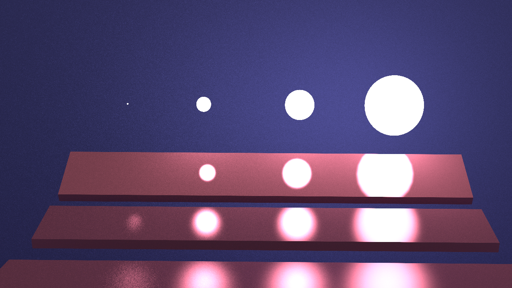
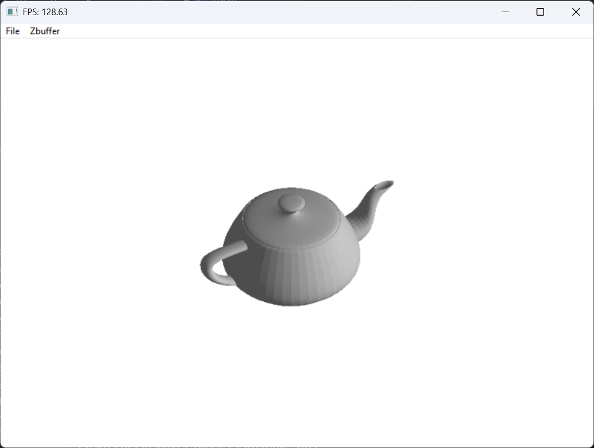

# Computer Graphics Projects

浙江大学《计算机图形学及应用》与《应用几何造型基础》课程项目合集

**CPU Path Tracing · Software Rasterization · Geometric Modeling**

本仓库以图形/引擎开发为主线，核心内容是一个 CPU Monte Carlo 路径追踪器和一个 CPU 软件光栅化器，同时包含扫掠曲面与 NURBS 曲面处理项目。项目均使用 C/C++ 实现，覆盖从模型加载、几何求交、空间加速到光照计算和可见性判断的完整渲染流程。

## 项目概览

| 项目 | 主要内容 | 技术关键词 |
| --- | --- | --- |
| [CPU Monte Carlo 路径追踪器](CG_Project_final/readme.md) | 从 OBJ/MTL/XML 场景加载到渐进式图像输出的完整离线渲染流程 | C++17、KD-Tree、AABB、面积光源、Fresnel、OpenMP、GLFW |
| [CPU 软件光栅化器](CG_Project_midterm/ReadMe.md) | 在 CPU 上实现投影、着色、三角形光栅化和多种 Z-Buffer 算法 | Scanline Z-Buffer、Hierarchical Z-Buffer、KD-Tree、Direct3D 9 |
| [扫掠曲面与 NURBS 几何造型](GM_Project/readme.md) | 扫掠曲面生成、曲面微分属性计算和自相交检测 | C++、OpenGL、NURBS、Sweep Surface、ImGui |

## CPU Monte Carlo 路径追踪器

路径追踪器位于 [`CG_Project_final`](CG_Project_final/)，支持交互窗口和无窗口批处理两种运行方式。

主要实现：

- 使用 `tinyobjloader` 和 `tinyxml2` 加载 OBJ、MTL 与 XML 场景配置；支持纹理、Phong 材质参数和多个发光材质。
- 实现 Möller–Trumbore 三角形求交和鲁棒 AABB slab 测试，并使用 KD-Tree 加速场景求交。
- 对所有发光三角形按面积采样，通过 next-event estimation 和阴影射线计算直接光照。
- 支持余弦加权漫反射、Phong 高光，以及基于 Fresnel 系数选择的反射与折射事件。
- 使用 OpenMP 并行追踪像素，按迭代累积样本；使用线程局部随机数引擎避免并行数据竞争。
- 通过 GLFW 实时显示渐进渲染结果，也可以使用 `--headless` 输出 PNG、JPG 或 BMP。

### 渲染结果

<table align="center">
  <tr>
    <td align="center"> Bathroom2 · 5000 iterations</td>
    <td align="center"> Cornell Box · 5000 iterations</td>
    <td align="center"> Veach scene · 4000 iterations</td>
  </tr>
</table>

收敛过程：

完整的配置参数、命令行和实现说明见[项目 README](CG_Project_final/readme.md)。

## CPU 软件光栅化器

软件光栅化器位于 [`CG_Project_midterm`](CG_Project_midterm/)。模型变换、投影、Lambert 着色、三角形覆盖和深度判断均在 CPU 上完成；Direct3D 9 用于窗口显示和数学类型，不参与 Z-Buffer 计算。

项目实现并比较了五种可见性方案：

1. 不使用 Z-Buffer；
2. 朴素 Z-Buffer；
3. 扫描线 Z-Buffer；
4. 基于四叉树深度层次的 Hierarchical Z-Buffer；
5. KD-Tree 与 Hierarchical Z-Buffer 结合的层次剔除。

命令行程序可以批量输出五种算法的结果与耗时，GUI 程序支持模型加载、视角旋转和算法切换。

详见[项目 README](CG_Project_midterm/ReadMe.md) 中。

## 扫掠曲面与 NURBS 几何造型

[`GM_Project`](GM_Project/) 实现了扫掠曲面相关算法，包括：

- 三次均匀 B-Spline 曲线插值；
- Frenet 标架与双反射方法生成扫掠曲面；
- 剖面曲线变换和 NURBS 曲面构造；
- 曲面切向量、法向量和导数可视化；
- 基于空间采样与 KD-Tree 的曲面自相交检测。

详见 [项目 README](GM_Project/readme.md)。
